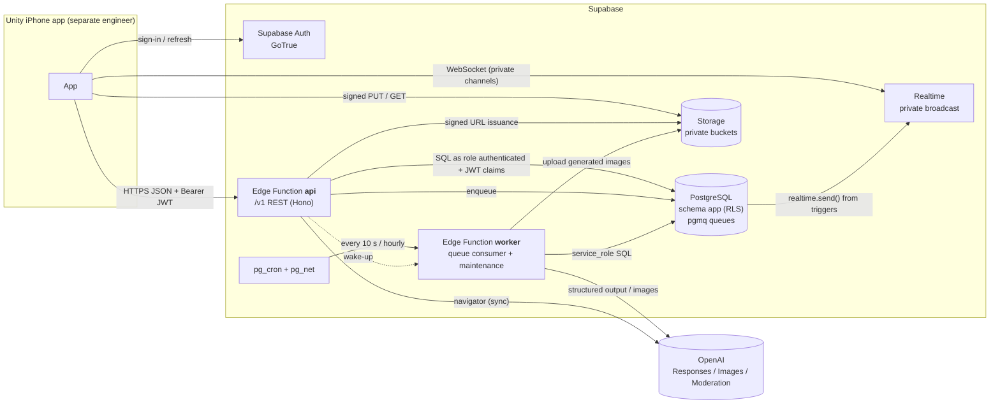
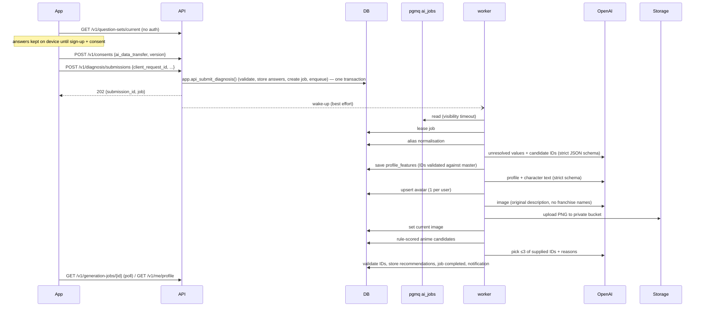

# Architecture

Contract-first modular monolith on Supabase. The ER diagram is in [`ER_DIAGRAM.md`](ER_DIAGRAM.md); the API contract is [`../openapi/openapi.yaml`](../openapi/openapi.yaml).

## 1. Components

The client talks only to **Auth**, the **`/v1` API**, **Realtime private channels** and **signed Storage URLs**. Secrets (OpenAI key, service-role key, DB URL, worker secret) exist only in Edge Function secrets.

## 2. Modules (inside `supabase/functions/_shared`)

| Module | Responsibility |
|--------|----------------|
| `http/` | Router, request ID, error envelope, JSON validation (Ajv + `schemas/api`), idempotency, rate limiting |
| `auth/` | JWT verification (JWKS ES256/RS256 or legacy HS256), account-status gate |
| `db/` | Postgres pool; `asUser(claims, fn)` runs a transaction as `authenticated` with JWT claims set so RLS applies; `asService(fn)` for the worker |
| `domain/*` | consent, questions, diagnosis, profile, recommendations, guilds, chat, attachments, reactions/growth, notifications, navigator, safety, account |
| `ai/` | `AiProvider` interface (OpenAI and deterministic mock), prompt registry, output schema validation, cost estimation, `ai_runs` logging |
| `storage/` | `StorageGateway` interface (Supabase Storage, local filesystem emulator for Linux tests) |
| `jobs/` | Queue abstraction over pgmq, job lease/state machine, stage handlers |

Authoritative mutations are PostgreSQL functions in schema `app` (`SECURITY DEFINER`, fixed `search_path`, using `auth.uid()`). They use row locks and unique constraints for capacity, idempotency, reaction uniqueness and EXP. The TypeScript layer validates input, calls one function per mutation, and shapes responses.

## 3. Security model

1. **Schema isolation.** All tables live in schema `app`, which is **not** exposed through the Supabase Data API (PostgREST/GraphQL). `public` is left empty. Clients cannot query tables directly even with a valid JWT.
2. **RLS everywhere.** Every table in `app` has RLS enabled (not forced, so `SECURITY DEFINER` functions owned by the migration role can enforce their own checks). The API executes reads as role `authenticated` with `request.jwt.claims` set, so a bug in API code cannot bypass row ownership.
3. **No client write grants.** `authenticated` has `SELECT` only on the tables it needs (filtered by RLS) and `EXECUTE` only on the `app.api_*` functions. Inserts/updates happen inside those functions. `anon` has nothing except `app.api_get_current_question_set()`.
4. **Service-only functions** (`app.svc_*`) are granted to `service_role` only and are used by the worker.
5. **Identity** comes from the verified JWT `sub`; no request field is trusted as a user ID.
6. **Storage** buckets are private and have **no** `storage.objects` policies for `anon`/`authenticated`. Every access goes through short-lived signed URLs issued after an authorization check.
7. **Realtime** uses private channels. `realtime.messages` RLS allows `SELECT` (receive) only for `conv:{id}` topics the user is a member of and the user's own `user:{id}` topic. There is no `INSERT` policy, so clients cannot broadcast.
8. **Account status gate**: users whose deletion was requested receive `ACCOUNT_DELETED` on every endpoint except deletion status.

## 4. Data flows

### 4.1 Diagnosis (設計02-B, 設計03, 設計05-A)

Every stage is idempotent: it checks whether its output already exists for the job before calling AI, so a re-delivered queue message never duplicates profiles, avatars or images.

### 4.2 Message send (C-1, C-4)

`POST /v1/conversations/{id}/messages` → `app.api_send_message()`:
membership + block + rate check → `UPDATE conversations SET last_seq = last_seq + 1` (row lock serialises per conversation) → `INSERT messages` (unique `(sender_id, client_message_id)`; on conflict the existing row is returned) → trigger calls `realtime.send()` to `conv:{id}` with the event envelope. A reconnecting client calls `GET …/messages?after_seq=N`, which is complete because per-conversation `seq` is assigned in commit order.

### 4.3 グッと → EXP → evolution (設計07, 設計08)

`app.api_give_reaction()` in one transaction: insert reaction (unique giver+target) → append `exp_ledger` (unique per reaction) → lock and update `user_growth` → compute level from `level_rules` (cap 100) → notifications → if a 5-level boundary was crossed, enqueue one `evolution_image` job keyed `evolution:{user}:{stage}` (only the final stage is generated).

## 5. Asynchronous jobs

- `app.ai_jobs` is the source of truth (status, stage, attempts, lease, idempotency key). pgmq queue `ai_jobs` carries only `{job_id}`. The worker reaches pgmq only through `app.svc_queue_*` wrappers, so `service_role` needs no direct pgmq privileges.
- The worker reads with a visibility timeout and **leases** the job row (`locked_until`). A duplicate delivery that finds the job leased extends the message visibility; a delivery for a completed job is archived.
- `pg_cron` invokes the worker every 10 seconds (drain) and hourly for maintenance (orphan uploads, history purge, account-deletion processing, expired rate-limit buckets).
- **Portability:** the worker logic is `runWorkerBatch(deps)` with injected `AiProvider`, `StorageGateway` and DB. The same module can run in a Cloud Run container (`deno run worker-server.ts`) that polls the same pgmq queue. Only the cron target URL changes; the public API is unaffected.

## 6. Realtime

Topics:

| Topic | Members | Events |
|-------|---------|--------|
| `conv:{conversation_id}` | conversation members | `message.created`, `message.deleted`, `reaction.updated`, `read.updated` |
| `user:{user_id}` | that user | `notification.created`, `conversation.updated`, `growth.updated`, `generation.updated` |

Envelope: `{ "event_id": uuid, "type": "...", "occurred_at": ISO-8601 UTC, "data": {…} }`. Realtime is a delivery hint; PostgreSQL plus the REST API is the source of truth.

## 7. Environments

| | local | staging | production |
|---|---|---|---|
| Supabase | `supabase start` (Docker) or user-space PG + shim | dedicated project | dedicated project |
| AI provider | `mock` | `openai`, budget 5 USD/day | `openai`, budget per settings |
| Storage | Supabase local / filesystem emulator | Supabase | Supabase |
| Secrets | `.env.local` (generated, git-ignored) | Supabase secrets | Supabase secrets |

Configuration files: `.env.example`, `supabase/config.toml`, `supabase/seed/settings.{local,staging,production}.sql`.

## 8. Technology decisions

| Decision | Reason |
|----------|--------|
| Direct Postgres from Edge Functions (`postgres.js`) instead of PostgREST | Keeps tables unexposed, gives real transactions, and makes the API testable against plain PostgreSQL on Linux |
| Per-conversation sequence numbers | Gap-free catch-up after reconnect; cheap unread counts |
| Rate limits in Postgres | No Redis; volume is small at MVP scale |
| pgmq + `ai_jobs` table | Supabase Queues as requested; the table gives idempotency and observable state |
| Hono router | Small, runs in Deno / Supabase Edge / Cloud Run unchanged |
| Ajv JSON Schema validation | The same schemas validate API input and AI output and are published in `schemas/` |
