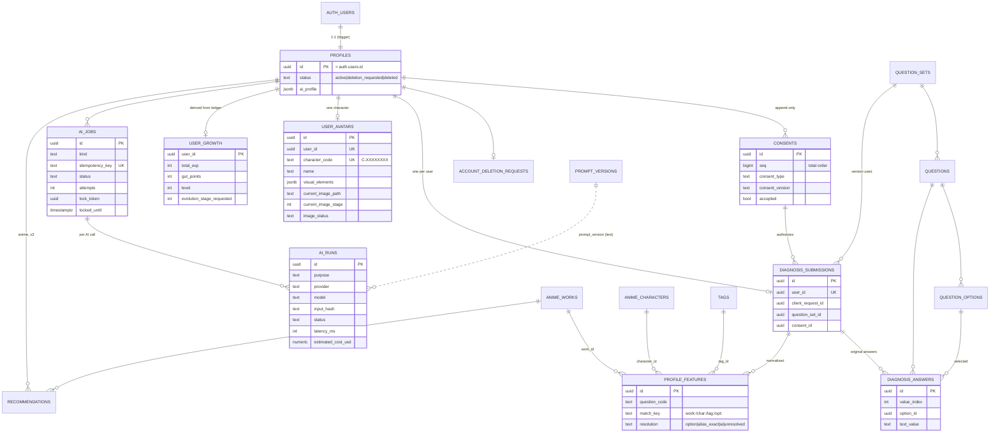
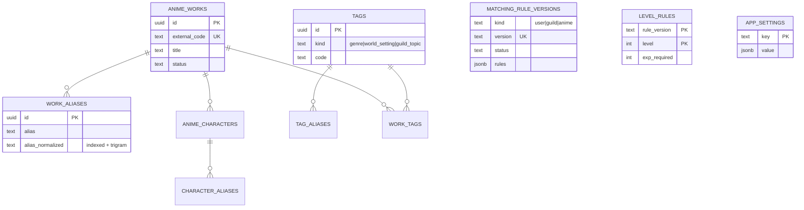
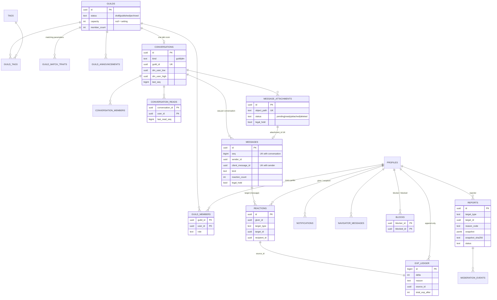

# ER Diagram

Schema `app` (PostgreSQL). Source of truth: `supabase/migrations/`. Only key columns are shown. Every table has RLS enabled (see `20261001000400_rls_and_grants.sql`).

## Accounts, consent, diagnosis and AI

## Anime master (client supplied) and rules

## Guilds, conversations and community

## Operational tables (service only)

`audit_logs` (append-only), `idempotency_keys`, `rate_limit_counters`, `moderation_events`, `prompt_versions`, `app_settings`, and the pgmq queue `ai_jobs`.

## Key constraints that enforce business rules

| Rule | Constraint |
|------|-----------|
| One diagnosis / character per user | `diagnosis_submissions.user_id` UNIQUE, `user_avatars.user_id` UNIQUE |
| Immutable character ID | `user_avatars.character_code` UNIQUE, no update path |
| No duplicate messages on retry | UNIQUE `(sender_id, client_message_id)` |
| Gap-free ordering | UNIQUE `(conversation_id, seq)`, seq assigned under `conversations` row lock |
| One グッと per user and target | UNIQUE `(giver_id, target_type, target_id)` |
| EXP applied once per source | UNIQUE `(user_id, reason, source_type, source_id)` on `exp_ledger` |
| One job per diagnosis / evolution stage | `ai_jobs.idempotency_key` UNIQUE |
| One DM thread per pair | UNIQUE `(dm_user_low, dm_user_high)`, CHECK low < high |
| Guild capacity | checked under `guilds` row lock in `app.api_join_guild` |
