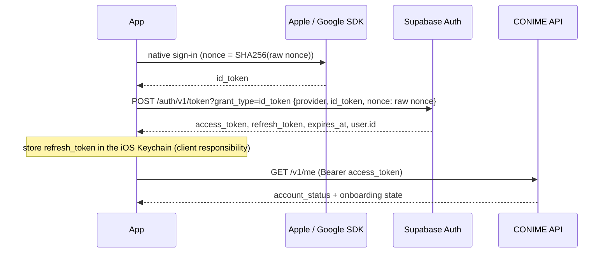
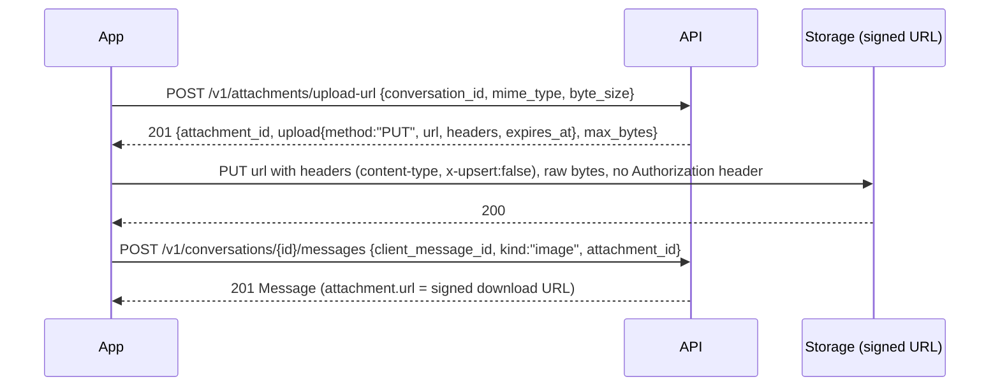
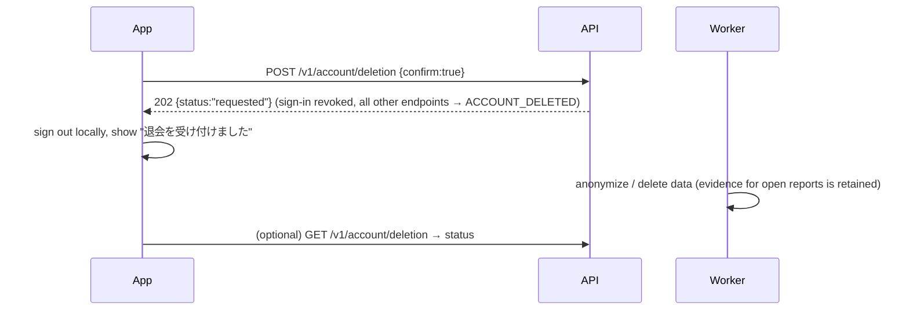

# Unity / iOS Integration Guide

Audience: the Unity engineer building the CONIME iPhone app. Everything here is integration-level; no UI is prescribed. Contract: [`openapi/openapi.yaml`](../openapi/openapi.yaml). Error codes: [`ERROR_CODES.md`](ERROR_CODES.md). Realtime: [`REALTIME.md`](REALTIME.md). C# DTOs: [`unity-contracts/Generated/ConimeApiDtos.cs`](../unity-contracts/Generated/ConimeApiDtos.cs) (generated from the contract). Example client: [`unity-contracts/Examples/ConimeApiClient.cs`](../unity-contracts/Examples/ConimeApiClient.cs).

## 1. Environments

| Environment | API base URL | Auth |
|-------------|-------------|------|
| Mock (no backend) | `http://127.0.0.1:4010` via `npm run mock` (Prism, generated from the contract) | any bearer token |
| Local backend | `http://127.0.0.1:8787` (Linux dev server) or `http://127.0.0.1:54321/functions/v1/api` (`supabase start`) | local test tokens |
| Staging | `https://<project-ref>.supabase.co/functions/v1/api` | Supabase Auth (test accounts) |
| Production | `https://<project-ref>.supabase.co/functions/v1/api` | Supabase Auth |

The client also needs the **Supabase URL** and the **publishable (anon) key** for Auth and Realtime. These are public values. The service-role key, OpenAI key and database credentials are never given to the client.

## 2. Conventions

| Topic | Rule |
|-------|------|
| Encoding | UTF-8 JSON. Japanese text is sent and returned as entered (no server-side width conversion except character names). |
| IDs | UUID strings. The character ID shown to users is `character_id` (`C-XXXXXXXX`). |
| Time | ISO 8601 UTC (`2026-10-01T09:30:00.000Z`). Parse with `DateTimeOffset.Parse(s, CultureInfo.InvariantCulture)` and convert to local time for display. |
| Auth header | `Authorization: Bearer <access_token>` on every endpoint except health, app-config and question set |
| Correlation | Every response has `X-Request-Id`. Log it with client errors. You may send your own UUID in `X-Request-Id`. |
| Errors | `{ "error": { code, message, request_id, details } }`. Branch on `code` only and show your own Japanese copy. |
| Timeout / retry | 15 s timeout; automatic retries after 2 s and 5 s for network errors, 5xx and `IDEMPOTENCY_IN_PROGRESS` (設計02-C). Values are also in `/v1/app-config.client_retry`. |
| Idempotency | For every mutation, generate one `Idempotency-Key` (UUID) per user action and reuse it for all retries of that action. Messages also carry `client_message_id`, and diagnosis carries `client_request_id`. |
| Pagination | `next_cursor` → pass back as `cursor`. Messages use `before_seq` / `after_seq` instead. |
| Unknown values | Tolerate unknown enum values (roles, notification types, event types) and extra JSON fields. |
| Server values | Never compute compatibility %, EXP, level or counts on the client. Display API values as returned (M-3, L-1, L-5). |
| Limits | Read limits from `GET /v1/app-config` (message length, upload types and size, name length, max level, evolution interval). Do not hard-code them. |

Serializer: use **Newtonsoft.Json** (`com.unity.nuget.newtonsoft-json`). `JsonUtility` cannot handle nullable fields, dictionaries (`stats`, `visual_elements`, `details`, `data`) or top-level arrays. The generated DTOs keep the JSON snake_case field names, so no attributes are needed. A Linux check deserializes 22 real API responses into these DTOs in strict mode (`tests/unity-contracts`). That is a .NET check, not a Unity/IL2CPP check.

## 3. Authentication (AC-1, 設計02-A)

Supabase Auth issues the access token (JWT, about 1 h) and the refresh token. The backend only verifies the access token.



| Call | Request |
|------|---------|
| Native sign-in | `POST {SUPABASE_URL}/auth/v1/token?grant_type=id_token`, headers `apikey: <publishable key>`, body `{"provider":"apple","id_token":"…","nonce":"<raw nonce>"}` (`"google"` likewise) |
| Test accounts (staging only) | `POST …/auth/v1/token?grant_type=password` `{"email","password"}` |
| Refresh | `POST …/auth/v1/token?grant_type=refresh_token` `{"refresh_token":"…"}`. Refresh tokens rotate, so store the new one. |
| Logout | `POST …/auth/v1/logout` with the access token, then delete local tokens |

Refresh about 60 s before `expires_at`, and also once when the API returns `TOKEN_EXPIRED`. If the refresh fails, or the API returns `TOKEN_INVALID`/`UNAUTHENTICATED`, go to re-login. `ACCOUNT_DELETED` means: sign out locally and show the account-deleted state.

Apple/Google provider credentials (Services ID, keys, client IDs) are configured in the Supabase project by the client. Native sign-in buttons, nonce generation and deep links are frontend responsibilities.

## 4. Registration, consent and diagnosis (Q-2, AC-2, 設計02-B)

```mermaid
sequenceDiagram
  participant App
  participant API
  App->>API: GET /v1/question-sets/current (no auth)
  Note over App: show questions; keep answers ON DEVICE ONLY (Q-2)
  App->>App: sign-up / sign-in (section 3)
  App->>API: GET /v1/me → onboarding.consent_required, consent_current_version
  App->>API: GET /v1/app-config (consent.ai_data_transfer.current_version)
  Note over App: show client-supplied consent text for that version
  App->>API: POST /v1/consents {consent_type:"ai_data_transfer", consent_version, accepted:true}
  App->>API: POST /v1/diagnosis/submissions {client_request_id, question_set_version, consent_version, answers[]}
  API-->>App: 202 {submission_id, job{id, status:"accepted", poll_after_seconds}}
  loop until status is completed or failed
    App->>API: GET /v1/generation-jobs/{job_id}
  end
  App->>API: GET /v1/me/profile, GET /v1/recommendations/anime
```

Answer format, using IDs from the question set:

```json
{
  "client_request_id": "b3c1…",            // generate once, persist with the stored answers
  "question_set_version": "qs-2026-10-v1",
  "consent_version": "2026-10-01",
  "answers": [
    { "question_id": "…Q1…", "texts": ["作品A", "", "作品C"] },   // free_text_fields: one entry per field
    { "question_id": "…Q7…", "texts": ["作品X、作品Y"] },          // free_text_multi: one field, any separators
    { "question_id": "…Q6…", "option_ids": ["…"] },               // single_choice
    { "question_id": "…Q9…", "option_ids": ["…", "…"] }           // multi_choice (≤ max_selections)
  ]
}
```

- `purposes` from the question set are informational. You may echo them (Q-6), but the server ignores them and uses its own master.
- `QUESTION_SET_OUTDATED`: fetch the new set, map stored answers by `code` (Q1…Q20), ask again where needed, then resubmit with a **new** `client_request_id`.
- A retry with the same `client_request_id` returns `200` with the original result. `DIAGNOSIS_ALREADY_SUBMITTED` means the user already has a diagnosis; continue with `details.job_id`.
- Job statuses: `accepted → normalizing_answers → generating_profile → generating_image → generating_recommendations → completed`, or `retrying` / `failed`. Poll every `poll_after_seconds`; it is `null` when the job is terminal. `generation.updated` on `user:{me}` can also trigger a refresh.
- On `failed` with `retryable: true`, offer a retry: `POST /v1/generation-jobs/{id}/retry`. The character text may already exist even if the image failed (`character.image.status = "failed"`).
- Results: `GET /v1/me/profile` (character, AI profile, display answers, favourites, growth) and `GET /v1/me/character` (設計04 image status). Anime recommendations: `status` `pending | ready | not_available`; 0 items is a valid empty state (Q-5).

## 5. Character (Q-3, Q-4, Q-7, L-3)

- `name` is `null` until the user names it: `PATCH /v1/me/character {"name":"…"}`. The server applies NFKC and trims. Errors: `CHARACTER_NAME_INVALID`, `CHARACTER_NAME_REJECTED`. `character_id` never changes.
- `image.url` is a signed URL valid until `image.url_expires_at` (about 1 h). Re-fetch the character for a fresh URL. Keep showing the previous image while `image.status = "generating"`, and on load failure (L-3, D-5).
- There is no history of past images and no regeneration endpoint (by specification).

## 6. Guilds and recommendations (G-1…G-5, M-1…M-4)

- `GET /v1/guilds?q=&membership=joined|not_joined&cursor=` lists published guilds (search covers name, description and tag names). Detail: `GET /v1/guilds/{id}`. `conversation_id` is present only for members.
- Join: `POST /v1/guilds/{id}/join` → `201` joined, `200` already a member. Errors: `GUILD_FULL` (show the full message), `GUILD_MEMBERSHIP_LIMIT_REACHED` (`details.limit`).
- Members and announcements (G-4) are member-only endpoints.
- `GET /v1/recommendations/users` returns `compatibility_percent`, `base_percent` and `matched_items[] {label, points, values}`; display them as returned. `GET /v1/recommendations/guilds` returns up to 3 guilds with `score`. To start a conversation from a recommendation (M-4), use `POST /v1/dm-threads {peer_user_id}`.

## 7. Messages (C-1…C-5)

```mermaid
sequenceDiagram
  participant App
  participant API
  participant RT as Realtime
  App->>App: client_message_id = UUID (persist with the pending bubble)
  App->>API: POST /v1/conversations/{id}/messages {client_message_id, kind:"text", text} + Idempotency-Key
  alt response lost / timeout
    App->>API: same request, same client_message_id and Idempotency-Key
    API-->>App: 200 (same message, no duplicate)
  else
    API-->>App: 201 Message {id, seq, ...}
  end
  RT-->>App: message.created (match by client_message_id; ignore if seq already shown)
```

- History: `GET …/messages` (newest page), `before_seq` (older), `after_seq` (catch-up). Items are always ascending by `seq`. Only the server's retention window is returned (C-5); do not keep or restore messages outside it.
- Unread: `unread_count` on conversations; mark read with `POST …/read {last_read_seq}`.
- DMs: `POST /v1/dm-threads {peer_user_id}` → `201` new / `200` existing. If `can_send` is `false`, check `cannot_send_reason` (`blocked`, `peer_deleted`); history stays readable.
- Sender info per message: `sender {display_name, character_id, level, role, avatar}`. `display_name` is `null` for unnamed or deleted users, so show your placeholder (B-04). Tolerate unknown roles (C-2).

### Image messages (signed upload)



- Allowed types and maximum size come from `/v1/app-config.attachments`. HEIC from the iOS photo picker is accepted. Converting to JPEG reduces size and improves compatibility (client choice).
- The server checks the real file bytes. `ATTACHMENT_CONTENT_MISMATCH` means the bytes are not the declared image type. `ATTACHMENT_NOT_UPLOADED` means the PUT has not completed; finish it, then retry. Upload slots expire after 10 minutes.
- Download URLs expire (about 1 h). Re-fetch with `GET /v1/attachments/{id}/download-url` or reload the page.

## 8. Realtime and token refresh

See [`REALTIME.md`](REALTIME.md). In short:

1. After sign-in, connect the Realtime socket with the publishable key, then join `user:{me}` and the open conversations as **private** channels, passing the access token.
2. After every token refresh, send the new access token to the open socket (`setAuth`). Otherwise the server closes channels when the old token expires.
3. On background, socket loss or resume: reconnect, re-join channels, and run REST catch-up (`after_seq`) for each visible conversation. Never treat realtime as complete.

Unity options: the community `supabase-csharp` / `realtime-csharp` libraries, or a Phoenix-protocol client over any WebSocket library (`NativeWebSocket` etc.). Verify them on device (see `IOS_VALIDATION_CHECKLIST.md`).

## 9. グッと, growth and notifications (C-3, L-1…L-5, NT-1)

- `POST /v1/reactions {target_type:"message", target_id}` → `201 {reaction_count}`. `ALREADY_REACTED` (409) means do not increment; use `details.reaction_count`. Own messages: `CANNOT_REACT_TO_SELF`.
- `GET /v1/me/growth` returns level, total EXP, グッとポイント, progress and `next_evolution_level`. When several levels are gained at once, show the final level from the response (L-2).
- `GET /v1/me/reactions/received` lists who gave グッと and when (L-4).
- `GET /v1/notifications?unread_only=` and `POST /v1/notifications/read {notification_ids[] | all:true}`. Types: `reaction_received`, `level_up`, `character_evolved`, `generation_completed`, `generation_failed`, `dm_received`. Ignore unknown types. Use `data` (`conversation_id`, `message_id`, `level`, `job_id`) for navigation.

## 10. Navigator (N-1, N-2)

- `GET /v1/navigator/messages` returns history, `default_suggestions` and `quota`. `POST /v1/navigator/messages {client_message_id, text}` → `{user_message, assistant_message{text, suggestions[], is_fallback}, quota}`.
- AI failure is **not** an error: `is_fallback: true` with a fixed message (N-2). `NAVIGATOR_QUOTA_EXCEEDED` (429, `details.resets_at`), `NAVIGATOR_INPUT_REJECTED` (422), `CONSENT_REQUIRED` (403).
- Report a navigator answer: `POST /v1/reports {target_type:"navigator_message", target_id, reason_code}`.

## 11. Safety, logout and account deletion (S-1, S-2, AC-3)

- Block: `POST /v1/blocks {user_id}` (201/200), `DELETE /v1/blocks/{user_id}` (204), `GET /v1/blocks`. The server applies all block effects; the app shows API results only (S-2).
- Report: `POST /v1/reports {target_type: message|attachment|navigator_message|avatar_image|user, target_id, reason_code, comment?}` → `202 {duplicate}`. Reason codes and labels come from `/v1/app-config.reports`.
- Logout: Supabase `POST /auth/v1/logout`, close the Realtime socket, delete Keychain tokens.
- Account deletion:



## 12. Error handling quick table

| Code(s) | Suggested client action |
|---------|------------------------|
| `TOKEN_EXPIRED` | Refresh once, then retry the same request |
| `UNAUTHENTICATED`, `TOKEN_INVALID` | Re-login |
| `ACCOUNT_DELETED` | Sign out, show the deleted state |
| `CONSENT_REQUIRED`, `CONSENT_VERSION_MISMATCH` | Show the consent screen for `details.required_version` / `current_version` |
| `QUESTION_SET_OUTDATED` | Re-fetch questions, remap answers by code |
| `VALIDATION_ERROR` | Show field hints from `details.fields[].path` (developer aid; avoid raw messages) |
| `RATE_LIMITED`, `NAVIGATOR_QUOTA_EXCEEDED` | Wait `Retry-After` / until `resets_at` |
| `GUILD_FULL`, `GUILD_MEMBERSHIP_LIMIT_REACHED`, `BLOCKED`, `ALREADY_REACTED` | Show the corresponding message; no retry |
| `IDEMPOTENCY_IN_PROGRESS`, 5xx, network | Automatic retry with the same `Idempotency-Key` |
| anything else | Generic error; include `request_id` in support logs |

## 13. What the backend does not do

UI, animations, sound; storing pre-registration answers or tokens; native sign-in UI; push notifications (not in scope); guild creation and event application (mock-only screens, no API); image history or regeneration.
