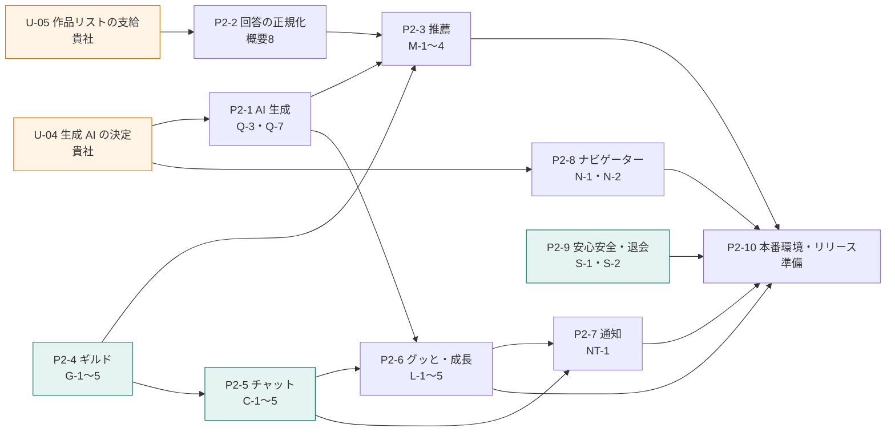

# 第2段階への引継ぎ資料（P2-1〜P2-10）

本書 引継03・引継04 の作業パッケージと依存関係に、第1段階で用意済みのもの（テーブル・API 契約・モック）と、差し替える箇所を加えた資料。
運営管理画面、ギルド作成・イベント申請・承認機能は、下記の後に仕様と優先順位を確認してお見積もりする。

## 依存関係（本書 引継03）

起点は貴社の「生成 AI の決定（U-04）」と「作品リストの支給（U-05）」。この2点が早いほど AI 生成・推薦・成長を前倒しできる。

矢印＝元が完了してから先を仕上げる依存。最長経路：ギルド → チャット → グッと・成長 → 通知。ギルド・安心安全は生成 AI と作品リストを待たずに着手可能。

## 作業パッケージ（本書 引継04）

| ID | 作業パッケージ | 主な内容 | 前提となる確認事項・作業 | 対応要件 |
|---|---|---|---|---|
| P2-1 | AI 生成の本実装 | 回答のパラメータ化、プロフィール・キャラ・初回画像の生成、品質調整 | U-04・U-08 | Q-3・Q-7 |
| P2-2 | 回答の正規化 | 自由記述を作品・キャラ・ジャンル・世界観のリストIDに紐付け | U-05 | 概要8 |
| P2-3 | 推薦 | ユーザー推薦（案A）・ギルド推薦・作品推薦（除外・加点・AI 理由） | P2-1・P2-2・P2-4・U-09 | Q-5・M-1〜M-4 |
| P2-4 | ギルド | 一覧・検索・参加（定員・上限）・お知らせ・メンバー、初期ギルド投入 | U-16 | G-1〜G-5 |
| P2-5 | チャット | トークルーム・DM、Realtime 配信、画像、未読、履歴上限 | P2-4・U-12〜U-14 | C-1・C-2・C-4・C-5 |
| P2-6 | グッと・成長 | グッと付与、ポイント・EXP・レベル、5レベルごとの進化画像 | P2-1・P2-5・U-10・U-11 | C-3・L-1〜L-5 |
| P2-7 | 通知 | グッと受領・レベルアップ・DM 等の通知保存と閲覧済み管理 | P2-5・P2-6・U-15 | NT-1 |
| P2-8 | ナビゲーター | AI 応答、履歴、利用上限、代替応答 | U-04・U-18 | N-1・N-2 |
| P2-9 | 安心安全・退会 | 通報・ブロックの反映、退会の実処理 | U-14・U-17 | S-1・S-2・AC-3 |
| P2-10 | 本番環境・リリース準備 | 本番構築、負荷・セキュリティ確認、監視、運用手順 | P2-1〜P2-9 | 非機能要件 |

## 第1段階で用意済みのものと差し替える箇所

第2段階では **API の契約（openapi.yaml）を変えずに** モックの中身を本実装へ差し替える。差し替えたルートは openapi.yaml の `x-conime-stage` を `live` に変え、`supabase/functions/api/routes/mocks.ts` から該当ルートを削除して実装ファイルへ移す（`contract_test.ts` がルーターと openapi.yaml の一致を検証する）。

| ID | 用意済みのテーブル・制約・関数 | 差し替えるモック API | 主な実装箇所 |
|---|---|---|---|
| P2-1 | `ai_profiles`・`characters`・`generation_jobs`（dedupe_key・再試行・タイムアウト）、worker | なし（実動作の診断 API の中身） | `_shared/ai/` に提供元の AiProvider を追加し `AI_PROVIDER` で切替。API キーは Edge Functions の Secrets |
| P2-2 | `answer_entities`・`works`・`anime_characters`・`tags`・`work_tags`（pg_trgm インデックス） | なし | 作品リストの取り込み、worker に正規化ジョブを追加 |
| P2-3 | `recommendations`（user_id, kind, rank）、`app_settings` `matching.weights`・`recommendation.max_items` | `GET /me/recommendations`、`GET /users/{user_id}` | worker の job_type = recommendation、pg_cron の毎日1回。`GET /me/diagnosis-result` の `recommendations.status` を ready に |
| P2-4 | `guilds`（定員 CHECK・名前の pg_trgm）・`guild_tags`・`guild_members`・`guild_announcements`、`private.is_guild_member` | `GET /guilds`・`GET /me/guilds`・`GET /guilds/{id}`・`POST /guilds/{id}/join`・announcements・members | 参加関数（行ロックで定員・`guild.max_memberships` を守る）を private に追加 |
| P2-5 | `conversations`（guild / dm / navigator）・`conversation_members`（last_read_at）・`messages`（INDEX(conversation_id, created_at DESC)）、`private.can_access_conversation`、`message-images` バケット | `GET /conversations?kind=dm`・`POST /conversations/dm`・`GET`・`POST /conversations/{id}/messages`・`POST /conversations/{id}/read`・`POST /uploads/message-images` | Realtime チャネル `conversation:{conversation_id}`（RLS 連動）、履歴上限の定期削除（pg_cron） |
| P2-6 | `goodtos`（UNIQUE(giver_id, target_type, target_id)・giver ≠ receiver）・`exp_events`・`level_thresholds`（is_evolution = 5の倍数）、`characters` の EXP・レベル列は更新権限なし | `POST /goodtos`・`GET /me/goodtos/received`・`GET /me/growth` | 付与関数（グッと・EXP・レベルを同じトランザクションで更新）、job_type = evolution_image |
| P2-7 | `notifications`（未読の部分インデックス・read_at の列権限） | `GET /me/notifications`・`POST /me/notifications/read` | 事象発生時（グッと受領・レベルアップ・DM 受信・お知らせ）に保存 |
| P2-8 | `conversations` kind = navigator、`app_settings` `navigator.daily_limit`、同意確認（実装済み） | `GET`・`POST /navigator/messages` | AiProvider に応答生成を追加。上限超過 429、生成 AI の障害時 503 AI_UNAVAILABLE |
| P2-9 | `reports`・`blocks`（RLS 済み）、`private.is_blocked`（公開ビュー・会話に反映済み）、`account_deletion_requests`、`private.purge_withdrawn_users()`（pg_cron） | `POST /reports`・`GET /me/blocks`・`POST /blocks`・`DELETE /blocks/{user_id}`・`POST /me/withdrawal` | 退会：profiles.status = withdrawn、全セッション失効（Auth Admin API）、30日後の物理削除 |
| P2-10 | dev の構築手順（[setup.md](setup.md)）、CI（[ci.yml](../.github/workflows/ci.yml)・[deploy-dev.yml](../.github/workflows/deploy-dev.yml)） | — | prod プロジェクト（MOCK_MODE=false）、負荷確認、監視（生成ジョブの失敗率・待ち件数）、運用手順 |

## 第1段階の実装上の注意（引継ぎ）

| 項目 | 内容 |
|---|---|
| 利用制限 | 1ユーザー60回/分は Edge Function のインスタンス内で数える簡易方式（`_shared/rate_limit.ts`）。規模拡大時は DB または外部ストアへ移す |
| JWT の検証 | 非対称鍵（JWT Signing Keys。CLI 2.x の local 既定は ES256）は JWKS、HS256 は `JWT_SECRET` で検証（`_shared/auth.ts`）。どちらの署名方式でも動作する |
| API 仕様の同梱 | `GET /docs` 用に `supabase/functions/api/openapi.yaml`（正の openapi/openapi.yaml のコピー）を同梱する。openapi.yaml を変更したらコピーも更新する（`contract_test.ts` が一致を検証） |
| モック応答 | `_shared/mock/fixtures.ts` は openapi.yaml の応答例と同じ内容。応答例を変えたら fixtures も更新し、`contract_test.ts` で一致を確認する |
| 画像 | MockProvider は Q13・Q14・Q18・Q19・Q20 に応じた 512×512 の PNG を生成する。本実装では AiProvider の `renderCharacterImage` を差し替える |
| 運営作業 | 管理画面がない間は Supabase Studio（postgres ロール）で登録する。Auth の app_metadata.role = admin のユーザーは RLS 上もギルド・お知らせ・質問セット・同意文書を登録できる |
