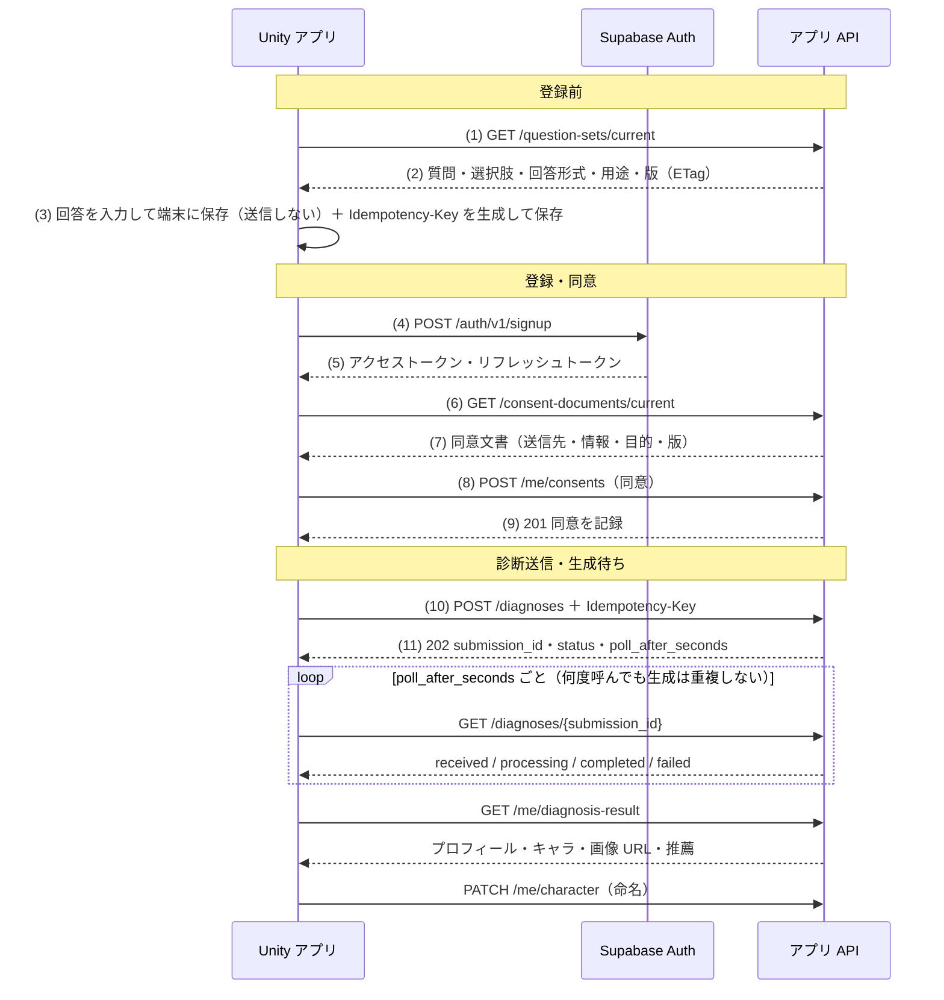

# Unity 側との連携手順書

本書 連携03〜05 の完全版。Unity（iPhone アプリ）開発担当が、第1段階の検証環境に対して「診断 → 登録 → 同意 → 回答送信 → 結果取得」を通しで実装し、残る画面も API 契約とモックで開発を進めるための資料。

- 必要なのは `UnityWebRequest` と JSON ライブラリ（Newtonsoft Json）だけで、Supabase 専用 SDK は不要
- API の正式な定義は [openapi/openapi.yaml](../openapi/openapi.yaml)（dev 環境では `GET /docs` で閲覧）
- C# 参考実装は [docs/unity/](unity/)（採用は任意）

## 1. 接続設定

| 項目 | 推奨 |
|---|---|
| 環境切替 | ScriptableObject（[ConimeApiConfig.cs](unity/ConimeApiConfig.cs)）に `AuthBaseUrl`・`ApiBaseUrl`・`AnonKey` を持たせ、local / dev / prod を環境ごとのアセットで切替 |
| 配布してよいキー | anon key のみ（公開前提のキー。権限は RLS で制御） |
| 配布しないキー | service_role key、生成 AI の API キー（サーバーからも共有しない） |
| JSON | Newtonsoft Json（`com.unity.nuget.newtonsoft-json`）。未知の項目を無視する設定（`MissingMemberHandling.Ignore`） |
| トークン保管 | リフレッシュトークンは iOS キーチェーン（ネイティブプラグイン経由。[AuthSession.cs](unity/AuthSession.cs) の `ISecureStore`）。アクセストークンはメモリのみ |
| エディタでの開発 | dev 環境、または Prism のローカルモック（`http://127.0.0.1:4010`）に接続 |

| 環境 | AuthBaseUrl | ApiBaseUrl |
|---|---|---|
| local | `http://127.0.0.1:54321/auth/v1` | `http://127.0.0.1:54321/functions/v1/api/v1` |
| dev | `https://<project-ref>.supabase.co/auth/v1` | `https://<project-ref>.supabase.co/functions/v1/api/v1` |
| Prism（ローカルモック） | `http://127.0.0.1:4010/auth/v1` | `http://127.0.0.1:4010` |

実機から local に接続する場合は `127.0.0.1` を PC の IP アドレスに置き換える（ATS の例外設定が必要）。

## 2. 通信の決まりごと

1. 全要求に `apikey` と `X-Client-Version`、会員 API に `Authorization: Bearer <アクセストークン>` を付ける
2. 作成系 POST は操作ごとに UUID を `Idempotency-Key` に入れ、再試行でも同じ値を使う。**診断送信のキーは回答と一緒に端末保存し、再起動後の再送でも同じ値を使う**
3. 分岐は HTTP ステータスではなく `error.code` で行う
4. 相性%・EXP・レベル・グッと累計は応答の値をそのまま使い、アプリで計算しない

| 状況 | 自動再試行 | 扱い |
|---|---|---|
| 通信断・15秒超過・500・503 | する（最大2回：2秒後・5秒後） | 上限後は手動再試行（設計02-C (6)） |
| 429 | Retry-After 秒後に1回 | その後は案内 |
| 400・403・404・409・422 | しない | `error.code` に応じた案内（下表） |
| 401 | リフレッシュ後に1回 | 失敗時は再ログイン画面へ |

### 応答形式

```json
{ "data": { "id": "6f1c…", "name": "ルミナ" }, "meta": { "next_cursor": null } }
```

```json
{
  "error": {
    "code": "VALIDATION_ERROR",
    "message": "answers[3].texts[0] max_length",
    "details": [ { "field": "answers[3].texts[0]", "reason": "max_length", "limit": 100 } ],
    "request_id": "req_…"
  }
}
```

- `message` は開発者向け。画面文言はアプリ側で持つ（応答内の表示文言は日本語のみ）
- 一覧はカーソル方式：`?limit=20&cursor=<meta.next_cursor>`。`next_cursor` が null なら末尾
- 日時は ISO 8601（UTC）。項目名は snake_case

### エラーコードとアプリの扱い（本書 API02）

| HTTP | code | アプリの扱い |
|---|---|---|
| 400 | VALIDATION_ERROR | 修正を案内（再試行しない）。`details[].field` と `reason` で該当項目を示す |
| 401 | UNAUTHENTICATED | ログイン画面へ |
| 401 | TOKEN_EXPIRED | リフレッシュ1回 → 失敗時は再ログイン |
| 403 | CONSENT_REQUIRED | 同意画面を表示 |
| 403 | FORBIDDEN | 案内を表示 |
| 403 | ACCOUNT_WITHDRAWN | トップへ |
| 404 | NOT_FOUND | 空状態または戻る（診断前のキャラ取得を含む） |
| 409 | ALREADY_SUBMITTED | 既存の状態取得へ（`details[0].submission_id`） |
| 409 | QUESTION_SET_OUTDATED | 定義を再取得し変更分を再回答 |
| 409 | DUPLICATE_GOODTO | 加算せず応答の累計を表示（`details[0].total_count`） |
| 409 | GUILD_FULL / GUILD_LIMIT_REACHED | その旨を表示（G-3・G-5） |
| 409 | ALREADY_MEMBER / GENERATION_IN_PROGRESS | 成功扱い / 状態取得を継続 |
| 422 | IDEMPOTENCY_KEY_REUSED | アプリの不具合として記録 |
| 429 | RATE_LIMITED | `Retry-After` 秒後に再試行 |
| 500 | INTERNAL_ERROR | 自動再試行 → 上限後は手動再試行 |
| 503 | AI_UNAVAILABLE | ナビゲーターは定型の代替メッセージ（N-2） |

Supabase Auth（`/auth/v1/*`）のエラーは形式が異なる（`{ "code": 400, "error_code": "invalid_credentials", "msg": "…" }`）。誤パスワードは 400 `invalid_credentials`、登録済みメールは 422 `user_already_exists`、短いパスワードは 422 `weak_password`。

## 3. 認証（本書 認証01）

| 操作 | 要求 |
|---|---|
| サインアップ | `POST {AuthBaseUrl}/signup` `{"email","password","data":{"display_name"}}` |
| ログイン | `POST {AuthBaseUrl}/token?grant_type=password` `{"email","password"}` |
| トークン更新 | `POST {AuthBaseUrl}/token?grant_type=refresh_token` `{"refresh_token"}` |
| ログアウト | `POST {AuthBaseUrl}/logout`（Authorization 付き） |

- アクセストークンは有効期限1時間。期限切れの要求は `401 TOKEN_EXPIRED` → リフレッシュを1回実行 → 元の要求を1回だけ再送（[ApiClient.cs](unity/ApiClient.cs)）
- リフレッシュトークンは使い捨てで、更新のたびに新しい値が返る。返ってきた値でキーチェーンを上書きする
- パスワードは8文字以上。dev はメール確認なし（サインアップの応答にトークンが含まれる）

## 4. 登録から結果取得まで（本書 認証02・API05）



### 4.1 質問定義（GET /question-sets/current）

- 認証不要。`ETag` を保存し、次回は `If-None-Match` に入れる（変更なしは 304）
- `answer_type` ごとの回答の作り方

| answer_type | 送る項目 | ルール（違反は 400） |
|---|---|---|
| single_choice | `option_codes: ["B"]` | ちょうど1つ・定義済みの code |
| multi_choice | `option_codes: ["A","C","D"]` | `min_select`〜`max_select` 個・重複なし |
| free_fields | `texts: ["作品A","作品B","作品C"]` | 要素数 = `field_count`。先頭から `required_field_count` 欄は空白のみ不可。各 `max_length` 以内 |
| free_multi | `texts: ["作品D、作品E"]` | 1要素・`max_length` 以内（区切りの解析はサーバー） |

- 文字数は Unicode のコードポイント数（絵文字1つ = 1文字）で数える
- `required: true` の質問はすべて含める。未知の code・同じ code の重複は不可

### 4.2 診断送信（POST /diagnoses）

```json
{
  "question_set_id": "0b9d6c1e-5a4f-4c47-9d0a-000000000001",
  "question_set_version": 1,
  "answers": [
    { "question_code": "Q1", "texts": ["作品A", "作品B", "作品C"] },
    { "question_code": "Q6", "option_codes": ["B"] },
    { "question_code": "Q7", "texts": ["作品D、作品E"] },
    { "question_code": "Q9", "option_codes": ["A", "C", "D"] }
  ],
  "answered_at": "2026-10-20T03:10:00Z"
}
```

- `Idempotency-Key` 必須。通信断・タイムアウト時は **同じキー・同じ内容** で再送する（初回と同じ 202 と submission_id が返る）
- 送信は1ユーザー1回。2回目以降は `409 ALREADY_SUBMITTED`（`details[0].submission_id` で状態取得へ）
- 未同意は `403 CONSENT_REQUIRED` → 同意画面へ戻す
- 端末保存中に質問セットの版が上がった場合、旧版は30日間 deprecated として受け付ける（U-22）。それを過ぎると `409 QUESTION_SET_OUTDATED` → 定義を再取得し変更分を再回答

### 4.3 生成待ち・失敗・結果

| status | 意味 | アプリの扱い |
|---|---|---|
| received | 受付済み・生成待ち | 待機表示を続けて再取得 |
| processing | 生成中 | 待機表示を続けて再取得 |
| completed | 生成完了 | `GET /me/diagnosis-result` で結果を表示（SC-03・SC-04） |
| failed | 生成失敗。回答は保持済み | 再試行ボタン → `POST /diagnoses/{id}/retry`（回答の再送は不要） |

- サーバーは失敗時に最大3回自動で再試行し、待機上限（仮に3分・U-08）を超えると failed（`error_code: GENERATION_TIMEOUT`）にする
- `GET /me/diagnosis-result` は部分完了に備え `profile.status`・`image.status`・`recommendations.status` を持つ。推薦は第2段階で生成するため第1段階は `pending`
- `character.name` は初回 null。命名後に `PATCH /me/character {"name": "…"}`（1〜20文字・U-07）。キャラID（`public_code`）は変更できない
- 画像 URL は署名付き（1時間）。期限が切れたら `GET /me/character/image` で取り直す。進化履歴は保持しない（現在画像1件のみ）

### 4.4 アプリ起動時（SC-01）

ログイン済みなら `GET /me` を呼び、`next_action` で遷移先を決める。

| next_action | 遷移先 |
|---|---|
| consent_required | 同意画面 |
| diagnosis_required | 端末保存の回答があれば送信、なければ AI 診断 |
| generating | 生成待ち（`diagnosis.submission_id` で状態取得） |
| retry_required | 再試行ボタンを表示 |
| ready | スクエア |

## 5. 画面と API の対応（本書 連携04）

| 画面 | 使用する API | 第1段階 |
|---|---|---|
| SC-01 トップ | ログイン済みなら `GET /me`（登録・診断状況で遷移先を決定） | 実動作 |
| SC-02 AI診断・質問 | `GET /question-sets/current` → 端末保存 → サインアップ → 同意 → `POST /diagnoses` | 実動作 |
| 生成待ち | `GET /diagnoses/{id}`（poll_after_seconds ごと） | 実動作 |
| SC-03・SC-04 誕生・結果 | `GET /me/diagnosis-result`、`PATCH /me/character`（命名） | 実動作 |
| SC-06 スクエア | `GET /me/recommendations`（user・guild・work）、`GET /me/notifications` | モック |
| SC-07 マイキャラ詳細 | `GET /me/character`、`GET /me/character/image`、`PATCH /me/character` | 実動作 |
| SC-08 ギルドホール | `GET /me/guilds`、`GET /guilds?q=` | モック |
| SC-09 ギルド詳細 | `GET /guilds/{id}`、`POST /guilds/{id}/join`、announcements、members | モック |
| SC-11・SC-17 トーク | `GET`・`POST /conversations/{id}/messages`、`POST /uploads/message-images`、`POST /goodtos`、`/read` | モック |
| SC-14 ナビゲーター | `GET`・`POST /navigator/messages` | モック |
| SC-15 通知・SC-16 DM一覧 | `GET /me/notifications`・`/read`、`GET /conversations?kind=dm`、`POST /conversations/dm` | モック |
| SC-18・SC-19 演出 | `GET /me/notifications`（goodto_received / level_up）、`GET /me/growth` | モック |
| SC-20 マイページ | `GET /me`、`GET /me/growth`、`GET /me/goodtos/received` | 一部実動作 |
| SC-22 通報・SC-23 設定 | `POST /reports`、`/blocks` 系、`POST /me/consents`（撤回）、`POST /me/withdrawal`、ログアウト | 一部実動作 |

モック API は openapi.yaml の応答例と同じ内容を返す。第2段階で同じ契約のまま中身を本実装へ差し替えるため、**モックに合わせて実装すれば Unity 側の改修は不要**。会員認証・入力検証（400）・`X-Mock-Scenario` は本実装と同じ扱い。

トークルーム・DM の新着受信は、第2段階で Supabase Realtime のチャネル `conversation:{conversation_id}` を追加する。切断からの復帰時は履歴 API で未取得分を取得する。

## 6. 異常系の再現（X-Mock-Scenario・dev のみ）

`ConimeApiConfig.MockScenario`（ヘッダー `X-Mock-Scenario`）で、dev 環境の応答を異常系に切り替えられる。本番では無視される。

| 値 | 再現される状態 |
|---|---|
| generation_failed | 診断送信（または再試行）後に status が failed |
| generation_slow | completed まで60秒 |
| empty | 一覧・推薦が0件（空状態） |
| guild_full / duplicate_goodto | 409 GUILD_FULL / 409 DUPLICATE_GOODTO |
| token_expired | 401 TOKEN_EXPIRED |
| rate_limited | 429 RATE_LIMITED（Retry-After: 10） |
| server_error / timeout | 500 / 20秒無応答（15秒待機を超える） |
| ai_unavailable | 503 AI_UNAVAILABLE（ナビゲーター） |

## 7. C# 参考実装（docs/unity/）

| ファイル | 内容 |
|---|---|
| [ConimeApiConfig.cs](unity/ConimeApiConfig.cs) | 接続設定（ScriptableObject） |
| [ApiClient.cs](unity/ApiClient.cs) | 共通ヘッダー・冪等キー・自動再試行・401 時のリフレッシュと1回だけの再送 |
| [ApiResult.cs](unity/ApiResult.cs) | `data` / `error` の解釈、エラーコード定数 |
| [AuthSession.cs](unity/AuthSession.cs) | サインアップ・ログイン・リフレッシュ・ログアウト、キーチェーン保存の抽象化（`ISecureStore`） |
| [Models.cs](unity/Models.cs) | 第1段階の実動作 API の DTO |
| [DiagnosisFlow.cs](unity/DiagnosisFlow.cs) | 回答の端末保存 → 同意 → 送信 → 生成待ち → 再試行 → 結果 → 命名 |

```csharp
var session = new AuthSession(config, new KeychainStore());   // KeychainStore は ISecureStore の iOS 実装
var api = new ApiClient(config, session);
var flow = new DiagnosisFlow(api);

var set = await flow.LoadQuestionsAsync();
var pending = flow.StartAnswering(set);          // 回答を入力するたびに pending.Answers を更新して pending.Save()
await session.SignUpAsync(email, password);
await flow.AgreeAllAsync();                      // 同意画面で文言を表示したうえで記録
var (outcome, submissionId) = await flow.SubmitAsync(pending);
var status = await flow.WaitForCompletionAsync(submissionId);
if (status.Status == "failed") await flow.RetryAsync(submissionId);
var result = await flow.LoadResultAsync();
```

## 8. 連携開始のためにお渡しするもの（本書 連携05）

| 項目 | 内容 |
|---|---|
| dev 環境 | プロジェクト URL・anon key・状態別の検証アカウント（[setup.md](setup.md) 2.3） |
| API 仕様 | [openapi/openapi.yaml](../openapi/openapi.yaml) と閲覧用ページ（Redoc）の URL：`https://<project-ref>.supabase.co/functions/v1/api/v1/docs` |
| Postman | [コレクション](../postman/CONIME_Phase1.postman_collection.json)・環境ファイル（[local](../postman/local.postman_environment.json) / [dev](../postman/dev.postman_environment.json)） |
| 連携手順書 | 本書と C# 参考実装（[docs/unity/](unity/)） |
